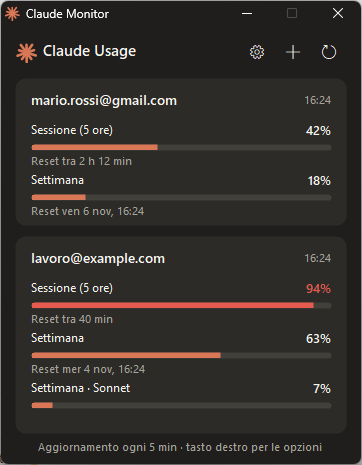
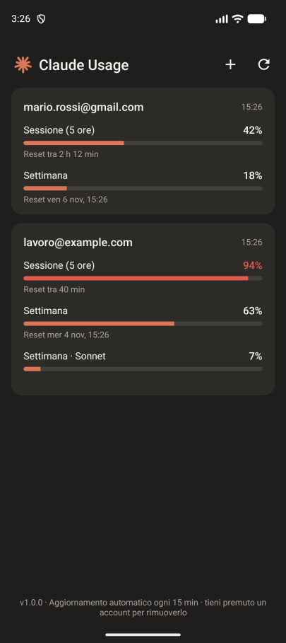
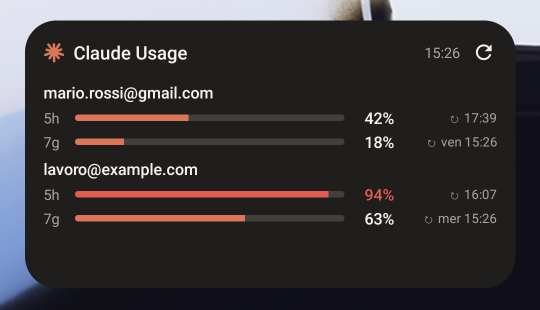

<p align="center">
  
</p>

<h1 align="center">Claude Monitor</h1>

<p align="center">
  Controlla i limiti di utilizzo dei tuoi account Claude (sessione di 5 ore e settimanale)<br>
  da Windows e Android, gratis, in un'app leggera a tema Claude.
</p>

<p align="center">
  <a href="https://github.com/carellice/claude-monitor/releases/latest/download/ClaudeMonitor.exe"><b>⬇ Windows (.exe)</b></a>
  &nbsp;·&nbsp;
  <a href="https://github.com/carellice/claude-monitor/releases/latest/download/ClaudeMonitor.apk"><b>⬇ Android (.apk)</b></a>
  &nbsp;·&nbsp;
  <a href="https://github.com/carellice/claude-monitor/releases">Tutte le release</a>
</p>

<p align="center">
  
  &nbsp;&nbsp;
  
</p>
<p align="center">
  
</p>

> Progetto personale e non ufficiale, non affiliato né approvato da Anthropic.
> "Claude" è un marchio di Anthropic, PBC.

## Funzioni

- **Più account**: collega tutti gli account Claude (Pro/Max) che vuoi e vedi i limiti uno sotto l'altro.
- **Limiti**: sessione di 5 ore, settimana e, quando presenti, i limiti settimanali Sonnet e Opus, con percentuale, barra e orario di reset. La barra diventa rossa dal 90%.
- **Windows**: un solo `.exe` da ~45 KB, nessuna installazione. Resta nell'area di notifica, con le percentuali nel tooltip. Opzioni: sempre in primo piano, avvio con Windows (anche ridotta nel tray).
- **Android**: app da ~60 KB con **widget per la home** ridimensionabile. Aggiornamento automatico ogni 15 minuti, anche dopo il riavvio.
- **Aggiornamenti integrati**: entrambe le app controllano le nuove versioni nelle release di questo repository e si aggiornano con un clic.

## Installazione

### Windows

1. Scarica [`ClaudeMonitor.exe`](https://github.com/carellice/claude-monitor/releases/latest/download/ClaudeMonitor.exe) e mettilo in una cartella a tua scelta.
2. Avvialo. L'exe non è firmato, quindi al primo avvio SmartScreen mostra "Windows ha protetto il PC": clicca **Ulteriori informazioni**, poi **Esegui comunque**.
3. Premi **+** e accedi con il tuo account Claude nel browser. Ripeti per ogni account.

Richiede Windows 10 (1903+) o Windows 11: usa il .NET Framework 4.8 già incluso nel sistema.

### Android

1. Scarica [`ClaudeMonitor.apk`](https://github.com/carellice/claude-monitor/releases/latest/download/ClaudeMonitor.apk) sul telefono e aprilo. Android chiede di consentire l'installazione di app da quella sorgente.
2. Apri l'app, premi **+** e accedi. Al termine tocca **Torna all'app**.
3. Tocca **Aggiungi widget alla home**, oppure aggiungilo dal menu widget del launcher.

Richiede Android 8.0 o successivo.

### Aggiornamenti

- **Windows**: quando esce una nuova versione, in fondo alla finestra compare *Nuova versione disponibile*: un clic la scarica, sostituisce l'exe e riavvia l'app. Puoi anche usare ⚙ → *Controlla aggiornamenti*.
- **Android**: compare un banner arancione in alto. Toccalo e conferma l'installazione. Al primo aggiornamento Android chiede di consentire a Claude Monitor l'installazione di app.

## Come funziona

Le app usano lo stesso login OAuth di Claude Code ("Accedi con l'account Claude") e leggono i limiti da `api.anthropic.com/api/oauth/usage`, lo stesso endpoint che Claude Code usa per `/usage`. Non servono chiavi API e non si consumano token.

- I token restano solo sul tuo dispositivo:
  - Windows: `%APPDATA%\ClaudeMonitor\accounts.dat`, cifrato con DPAPI (leggibile solo dal tuo utente Windows).
  - Android: cifrati con una chiave del Keystore di Android ed esclusi dai backup.
- Le app contattano solo `claude.com`/`platform.claude.com` (login), `api.anthropic.com` (limiti) e `api.github.com` (controllo aggiornamenti).
- I token sono separati da quelli di Claude Code: le due cose non interferiscono.

L'endpoint dei limiti non è documentato pubblicamente: un cambiamento da parte di Anthropic potrebbe romperlo.

## Compilare dai sorgenti

| | Requisiti | Comando |
|---|---|---|
| Windows | solo Windows 10/11 (usa il `csc.exe` del .NET Framework) | `powershell -ExecutionPolicy Bypass -File windows\build.ps1` |
| Android | JDK 17+ e Android SDK 36 | `cd android && gradlew.bat assembleRelease` |

Gli output finiscono in `dist\` (Windows) e `android\app\build\outputs\apk\` (Android). La versione di entrambe le app viene dal file [`VERSION`](VERSION).

## Pubblicare una release

```bat
release.bat          :: 1.0.0 -> 1.0.1
release.bat minor    :: 1.0.1 -> 1.1.0
release.bat major    :: 1.1.0 -> 2.0.0
```

Lo script incrementa `VERSION`, compila exe e APK, fa commit e tag, esegue il push e crea la release GitHub con i due file allegati. Le app già installate la troveranno da sole.

Requisiti: [`gh`](https://cli.github.com/) autenticato e la chiave di firma Android in `%USERPROFILE%\.claude-monitor\` (`release.jks` + `signing.properties`). La chiave non è nel repository: **fanne un backup**. Senza la stessa chiave, gli aggiornamenti Android non si installano sopra la versione precedente.

## Struttura

```
windows/   app Windows (C# WinForms, un solo file) e build.ps1
android/   app Android (Kotlin, nessuna libreria esterna) con widget
scripts/   script di release
docs/      logo e screenshot
VERSION    versione condivisa
```

## Licenza

[MIT](LICENSE)
